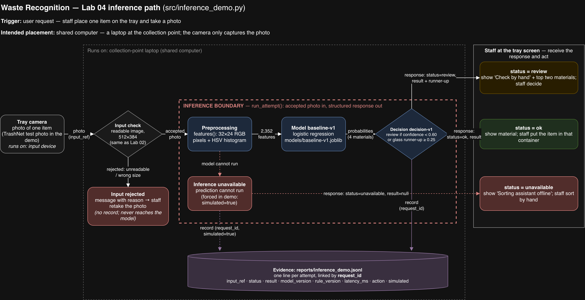
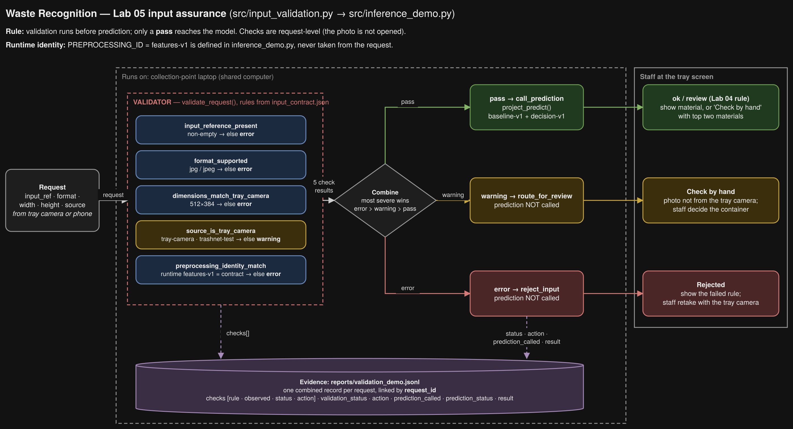

# Waste Recognition by Material

**Repository:** https://github.com/ibrahimtiamiyu48/waste-recognition

**Project direction:** We want to help staff at recycling collection points use photos of waste items to sort each item into the right material stream: plastic, paper, glass or metal.

## Team
- **Team name:** SortVision
- **Members:** Wu Wenxuan, Tiamiyu Ibrahim, Dorzhiev Erdeni, Gunzenov Burin-Jargal
- **Communication:** team Telegram group _(invite link shared inside the team only)_

## Documents
- [Project brief](docs/project_brief.md): user, input/output, data plan (Lab 01)
- [Data instructions](data/README.md): dataset, licence, where to put it (Lab 02)
- [Split strategy](docs/split_strategy.md): what is used for training and evaluation (Lab 02)
- [Project decisions](docs/project_decisions.md): required behavior, acceptance check, failure cases (Lab 03), inference path choices (Lab 04)
- [Inference architecture](docs/inference_architecture.drawio): editable diagram of the demo path (Lab 04)
- [Input contract](config/input_contract.json): validation rules (Lab 05)
- [Input validation flow](docs/input_validation_flow.drawio): editable diagram of the validation path (Lab 05)
- [Lab 05 path check](docs/lab05_check.md): teammate questions and answers (Lab 05)
- [Example service trace](reports/service_example.jsonl): one valid and one rejected request (Lab 06)
- [Dockerfile](Dockerfile) and [.dockerignore](.dockerignore): container for the API service (Lab 07)
- [Defense plan](docs/defense_plan.md): demo steps, fallback evidence, who explains what

## Run the baseline (Lab 02)
Environment: **Python 3.10 or newer** (tested with 3.13). Run from the repository root:

```bash
git clone https://github.com/ibrahimtiamiyu48/waste-recognition.git
cd waste-recognition
python -m venv .venv
source .venv/bin/activate          # Windows: .venv\Scripts\activate
pip install -r requirements.txt
python src/baseline_pipeline.py
```

The first run downloads TrashNet (~43 MB) into `data/raw/` and unzips it. Without internet access, follow [data/README.md](data/README.md) to place the files by hand.

The command creates or updates **`reports/baseline_metrics.json`**, which holds the measured macro F1 and the run's limitation. It also saves the trained model to `models/baseline-v1.joblib` (not committed), which the Lab 04 demo reuses. A run takes about a minute on a laptop.

Different library versions can change one or two test predictions. We have seen macro F1 0.6067 and 0.6042; glass recall stayed 0.50 in both.

## Run the inference demo (Lab 04)
Run the baseline above first, so the model file exists. Then, from the repository root:

```bash
python src/inference_demo.py --input-ref data/raw/dataset-resized/glass/glass373.jpg
```

The command classifies one photo twice: a normal attempt using the baseline model, and a simulated attempt where inference is unavailable. It writes both records to **`reports/inference_demo.jsonl`** (one JSON line each, overwritten on every run). The path is drawn in [docs/inference_architecture.drawio](docs/inference_architecture.drawio); open it at https://app.diagrams.net.

To see a `review` result, use `--input-ref data/raw/dataset-resized/glass/glass194.jpg`.



## Run the input-assurance demo (Lab 05)
Run the baseline first (so the model and photos exist). Then, from the repository root:

```bash
python src/inference_demo.py
python -m unittest tests/test_input_validation.py
```

The first command sends three requests through the validator in `src/input_validation.py`, using the rules in **`config/input_contract.json`**, before prediction. It prints one `pass`, one `error` and one `warning` result, and writes one combined record per request to **`reports/validation_demo.jsonl`**. Only the passing request reaches `project_predict()`. The tests prove that an error overrides a warning, that a warning does not call prediction, and that a pass does.

The path is drawn in [docs/input_validation_flow.drawio](docs/input_validation_flow.drawio). The answers to the teammate check are in [docs/lab05_check.md](docs/lab05_check.md).



## Run the API service on the team VM (Lab 06)
The service puts the Lab 04–05 path behind HTTP. `POST /predict` takes a photo, decodes it, and runs the Lab 05 checks on the **decoded** format and size. Only a passing photo reaches `baseline-v1`. Every request is appended to `reports/service_predictions.jsonl` on the VM. `GET /health` shows which service, model, rule, contract and preprocessing are running.

**VM:** Ubuntu 24.04 LTS · 2 vCPU · 4 GB RAM · 10–20 GB SSD · public IPv4 · your SSH public key.

On the VM (after `ssh <username>@<public-ip>`):

```bash
sudo apt update && sudo apt install -y python3-venv git
git clone https://github.com/ibrahimtiamiyu48/waste-recognition.git
cd waste-recognition
python3 -m venv .venv && source .venv/bin/activate
python3 -m pip install --upgrade pip
python3 -m pip install --no-cache-dir -r requirements.txt
python3 -m unittest tests/test_app.py tests/test_input_validation.py   # no model needed
python3 src/baseline_pipeline.py                                       # downloads TrashNet, saves models/baseline-v1.joblib
python3 -m uvicorn app:app --app-dir src --host 0.0.0.0 --port 8000
```

The repository is private, so `git clone` asks for a GitHub username and a **personal access token** (not your password). Alternatively, copy the folder from your computer with `scp -r waste-recognition <username>@<public-ip>:~/`.

Open `http://<public-ip>:8000/health` and `http://<public-ip>:8000/docs`. `model_loaded` is `false` until the first valid photo arrives.

**Demo from another computer** (in a clone of this repository):

```bash
bash scripts/demo_requests.sh <public-ip>
```

Alternatively, use `/docs` → `POST /predict` → *Try it out*. Upload `examples/glass373.jpg` (request ID `req-cloud-001`); it reaches the model and returns HTTP 200 with material and confidence. Then upload `examples/not_an_image.txt`; it returns HTTP 400 with `status: error`, `action: reject_input` and `prediction_called: false`. To see both decisions on the VM, stop the server with Ctrl+C and run:

```bash
tail -n 2 reports/service_predictions.jsonl
```

[`reports/service_example.jsonl`](reports/service_example.jsonl) is a committed example of those two records. The live log is not committed. Do not commit `.env`, SSH keys or tokens. Stop the VM when the team is not using it.

## Run the service in Docker (Lab 07)
The image holds the code, Python and packages. Three things are connected when the container starts and are never baked into the image:

| On the VM | In the container | How |
| --- | --- | --- |
| `models/` (trained by `baseline_pipeline.py`) | `/app/models` | read-only bind mount |
| `reports/` (evidence) | `/app/reports` | bind mount, so records survive container replacement |
| `.env` (from `.env.example`) | environment | `--env-file` |

On the VM, in `~/waste-recognition` (after the Lab 06 steps, so `models/baseline-v1.joblib` exists):

```bash
sudo apt update && sudo apt install -y docker.io docker-buildx
sudo systemctl enable --now docker
git pull
cp .env.example .env
mkdir -p reports

sudo docker build -t waste-recognition-service:1 .
sudo docker run --rm waste-recognition-service:1 \
  python -m unittest tests/test_app.py tests/test_input_validation.py

sudo docker run --rm --name waste-recognition \
  -p 8000:8000 \
  --env-file .env \
  --mount type=bind,src="$(pwd)/models",dst=/app/models,readonly \
  --mount type=bind,src="$(pwd)/reports",dst=/app/reports \
  waste-recognition-service:1
```

From another computer, run `bash scripts/demo_requests.sh <public-ip>` (or use `/docs`). Then stop the container with Ctrl+C and run `tail -n 2 reports/service_predictions.jsonl`.

**Replace the container and check the evidence:**

```bash
sudo docker run -d --rm --name waste-recognition \
  -p 8000:8000 --env-file .env \
  --mount type=bind,src="$(pwd)/models",dst=/app/models,readonly \
  --mount type=bind,src="$(pwd)/reports",dst=/app/reports \
  waste-recognition-service:1
sudo docker logs waste-recognition          # wait for "Application startup complete"
curl http://localhost:8000/health           # new container answers; model_loaded=false until the first photo
tail -n 2 reports/service_predictions.jsonl # earlier records are still there
sudo docker stop waste-recognition
```

If port 8000 is busy, stop the Lab 06 Uvicorn process (Ctrl+C in its window) or the old container (`sudo docker stop waste-recognition`).
