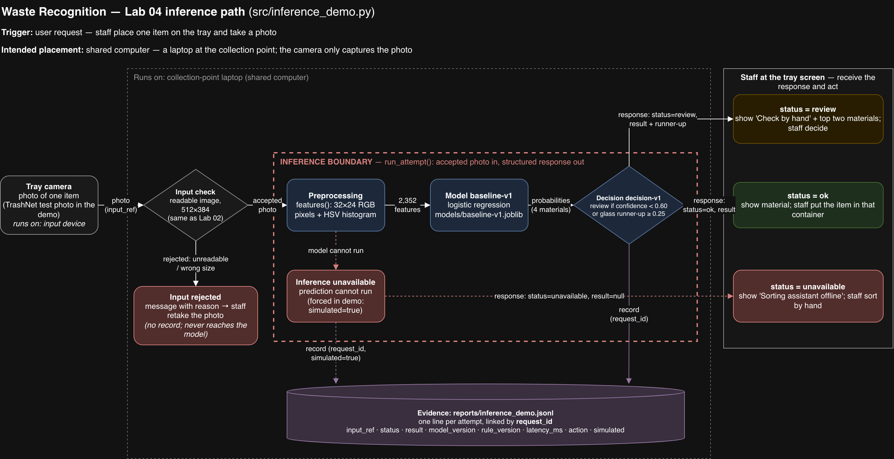

# Waste Recognition by Material

**Repository:** https://github.com/ibrahimtiamiyu48/waste-recognition

**Project direction:** We want to help staff at recycling collection points use photos of waste items to sort each item into the right material stream: plastic, paper, glass or metal.

## Team
- **Team name:** SortVision
- **Members:** Wu Wenxuan, Tiamiyu Ibrahim, Dorzhiev Erdeni, Gunzenov Burin-Jargal
- **Communication:** team Telegram group _(invite link shared inside the team only)_

## Documents
- [Project brief](docs/project_brief.md): user, input/output, data plan (Lab 01)
- [Data instructions](data/README.md): dataset, licence, where to put it (Lab 02)
- [Split strategy](docs/split_strategy.md): what is used for training and evaluation (Lab 02)
- [Project decisions](docs/project_decisions.md): required behavior, acceptance check, failure cases (Lab 03), inference path choices (Lab 04)
- [Inference architecture](docs/inference_architecture.drawio): editable diagram of the demo path (Lab 04)

## Run the baseline (Lab 02)
Environment: **Python 3.10 or newer** (tested with 3.13). Run from the repository root:

```bash
git clone https://github.com/ibrahimtiamiyu48/waste-recognition.git
cd waste-recognition
python -m venv .venv
source .venv/bin/activate          # Windows: .venv\Scripts\activate
pip install -r requirements.txt
python src/baseline_pipeline.py
```

The first run downloads TrashNet (~43 MB) into `data/raw/` and unzips it. Without internet access, follow [data/README.md](data/README.md) to place the files by hand.

The command creates or updates **`reports/baseline_metrics.json`**, which holds the measured macro F1 and the run's limitation. It also saves the trained model to `models/baseline-v1.joblib` (not committed), which the Lab 04 demo reuses. A run takes about a minute on a laptop.

Different library versions can change one or two test predictions. We have seen macro F1 0.6067 and 0.6042; glass recall stayed 0.50 in both.

## Run the inference demo (Lab 04)
Run the baseline above first, so the model file exists. Then, from the repository root:

```bash
python src/inference_demo.py --input-ref data/raw/dataset-resized/glass/glass373.jpg
```

The command classifies one photo twice: a normal attempt using the baseline model, and a simulated attempt where inference is unavailable. It writes both records to **`reports/inference_demo.jsonl`** (one JSON line each, overwritten on every run). The path is drawn in [docs/inference_architecture.drawio](docs/inference_architecture.drawio); open it at https://app.diagrams.net.

To see a `review` result, use `--input-ref data/raw/dataset-resized/glass/glass194.jpg`.


